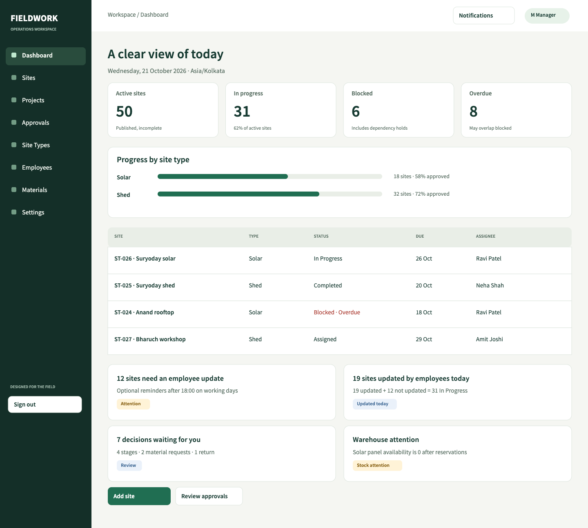

# Work Site Tracking System

Manager web and employee mobile product design for linked work sites, evidence approval, inventory, and offline field updates.

- [System design v0.2](docs/system-design.md)
- [Design delivery and review guide](design/README.md)
- [Editable Penpot file](design/deliverables/fieldwork-designs.penpot)
- [Client screen review PDF](design/deliverables/design-review.pdf)
- [User journeys and screen inventory](design/deliverables/user-journeys.md)
- [Requirements coverage and verification](design/deliverables/coverage-report.md)

The confirmed application stack is Java Spring Boot, SQLite, React, and Flutter. This repository currently contains product/system design and executable design-review tooling, not the production backend or mobile application.

## Review the designs

```sh
npm ci
npm run design:review
```

Open http://127.0.0.1:4173. Import the `.penpot` file into Penpot to edit boards, use prototype flows, and collect shared client comments. The browser gallery also supports review notes saved locally on the reviewer's device.

152 screen/state boards cover the manager and employee experiences, including 14 Hindi/Gujarati examples. The native file also includes nine user journey maps, shared design tokens, and seven foundation/component boards.



## Rebuild and verify

```sh
npm run design:build
npm run design:test
# Start the review server in another terminal before running browser QA:
node design/tools/browser-qa.mjs
node design/tools/report.mjs
```

Browser checks require a local Google Chrome installation. Actual native import verification additionally requires a running Penpot instance and a local authenticated test-account state; see the delivery guide. Credentials, browser sessions, Docker volumes and local runtime files are excluded from Git.

The verification report separates design coverage from the backend integration and native-device checks required during implementation.
