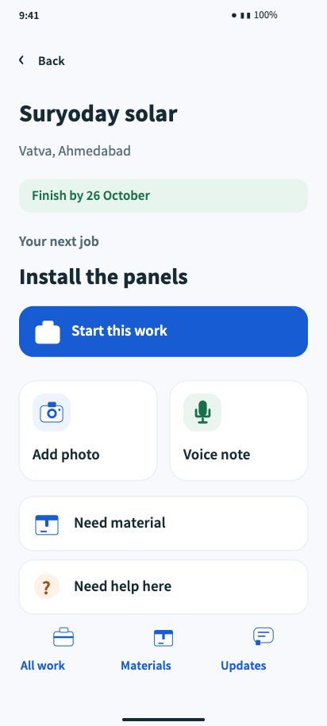
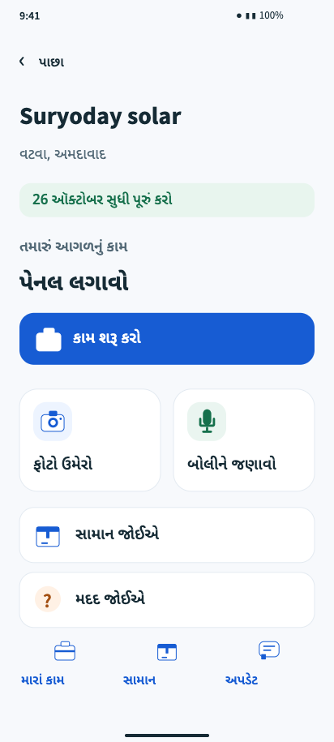

# Work Site Tracking System

Product and system design for a manager web app and a simple employee mobile app.

- [Open the simple employee demo — Gujarati](http://127.0.0.1:4173/employee.html#M46)
- [Employee demo — English](http://127.0.0.1:4173/employee.html#M04)
- [Eight-page client walkthrough](design/deliverables/client-review.pdf)
- [Editable Penpot file](design/deliverables/fieldwork-designs.penpot)
- [System design v0.2](docs/system-design.md)
- [System design PDF](design/deliverables/system-design.pdf)
- [Client review guide](design/deliverables/client-review-guide.pdf)
- [Employee usability rationale and proposed field check](design/specs/employee-usability.md)
- [Complete design delivery guide](design/README.md)
- [Requirements and verification](design/deliverables/coverage-report.md)

The employee app shows one next job and large, labelled photo, voice and material actions. Photos and voice notes can be sent without typing. Hindi/Gujarati variants cover the main task chains, confirmations, messages and help. Detailed work lists, material balances and update history remain available as secondary actions.

 

216 screen/state designs include 80 manager screens and 136 employee screens/states, including 74 Hindi/Gujarati variants. Screen IDs include task states and language variants, not a hierarchy of 212 product pages. The Penpot file also includes nine journey maps, seven foundation/component boards and seven prototype starting flows.

The confirmed product stack is Java Spring Boot, SQLite, React and Flutter. This repository contains designs and executable review tooling; the production backend and mobile application are not implemented here.

## Review

```sh
npm ci
npm run design:review
```

Open http://127.0.0.1:4173/employee.html for the uncluttered employee prototype, or http://127.0.0.1:4173 for all screens and review notes. Import the `.penpot` file into Penpot for editing, native prototype flows and shared comments.

## Rebuild and verify

```sh
npm run design:build
npm run design:test
# Start design:review in another terminal before these checks:
npm run design:browser-test
npm run design:employee-preview
npm run design:client-review
npm run design:report
npm run design:package
# Generate a small client ZIP with the guide, design walkthrough and system PDF:
npm run design:handoff
```

Build and browser checks require installed Google Chrome. Native import verification additionally requires the local Penpot instance and its ignored authenticated browser state. Credentials, Docker volumes and local runtime files are excluded from Git.

Checks cover design geometry, core typography, tap paths, selected-language continuity and requirements annotations. Real employee usability, native permissions, recording, inventory transactions and durable offline storage require field/device/integration validation during implementation.
