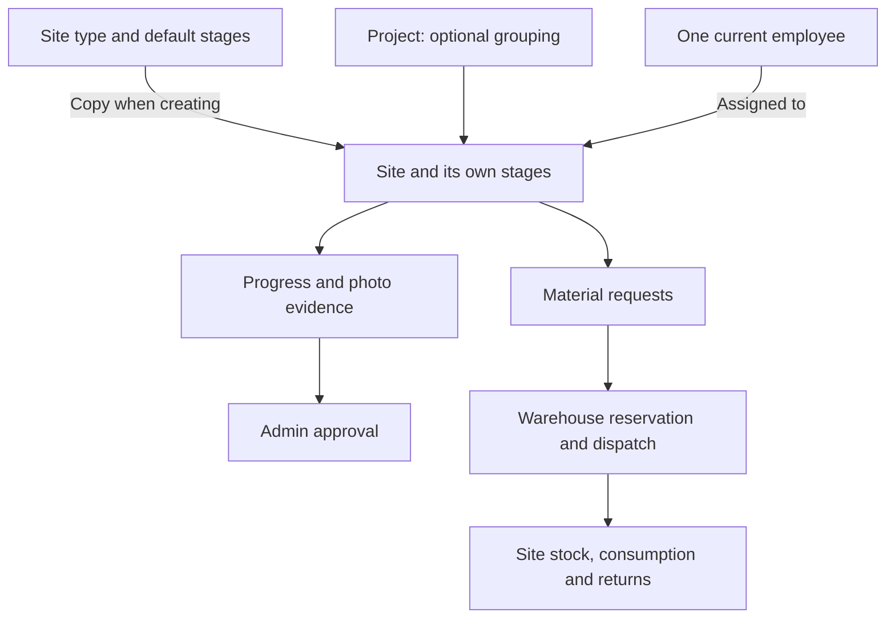
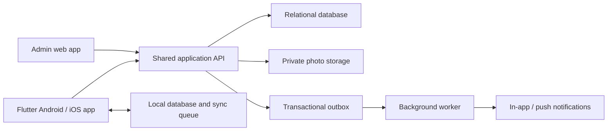

# Work Site Tracking System — Product and System Design

Version: 0.1 · Date: 21 October 2026 · Status: Design draft for discussion

This document describes the proposed first release. Decisions explicitly confirmed in discussion are listed below. Other business rules are proposals, so they can be changed before implementation. No application or database has been implemented yet.

## 1. Purpose and confirmed scope

Give one manager a reliable view of work across sites, and give employees a simple mobile workflow for reporting progress, submitting evidence, and tracking materials, including when connectivity is unavailable.

| Area | Confirmed decision |
| --- | --- |
| Manager | One admin account, provisioned directly through a Python script; no registration |
| Manager application | Web application in English |
| Employee application | Flutter application for Android and iOS, with offline work and synchronization |
| Employee languages | English, Hindi, Gujarati; admin selects language when creating/editing an employee |
| Assignment | At most one current employee per site; unassigned sites are allowed |
| Initial scale | Approximately 50 active sites and 20 employees |
| Site types | Configurable types, icons, and default stages with evidence requirements |
| Stage execution | Stages may run in parallel unless an explicit dependency prevents it |
| Completion | Employees request stage completion; admin approval completes a stage; approval of all stages completes the site |
| Linked sites | Group sites under a project, with optional dependencies between sites |
| Inventory | Track warehouse stock, site stock, consumption, and returns |
| Consumption and returns | Employee records consumption and requests returns; admin confirms returned stock received |
| Material requests | Multiple simultaneous requests allowed, including repeated requests for the same material |
| Fulfillment | Approval and physical dispatch are separate; provide an Approve & Dispatch shortcut |

### Proposed defaults awaiting review

- One organization and one warehouse in the first release.
- Business timezone: Asia/Kolkata. Dates such as “today” and due dates use this timezone.
- An employee has one eligible site type initially, matching the requested employee form. Assignment requires a matching type. This can become multiple eligible types if employees work across specialties.
- A stage with evidence required needs at least one successfully uploaded photo in its completion submission.
- Overdue is a separate flag, so a site can be both Blocked and Overdue.
- No additional site completion approval is needed after the final stage is approved.
- Outstanding materials or requests create a closeout warning but do not prevent work completion; material reconciliation remains available afterward.
- Daily progress notes are supported, but a daily submission is not mandatory initially.

## 2. Vocabulary and product model

| Concept | Meaning | Example |
| --- | --- | --- |
| Site type | Reusable work category and stage template | Solar, Shed |
| Project | Optional parent grouping related work sites | ABC Factory Upgrade |
| Site | An independently assigned and tracked work package | ABC Factory — Shed |
| Stage | A unit of work inside a site | Foundation, Structure, Inspection |
| Dependency | A prerequisite that must be approved/completed before other work can start | Shed completed before Solar starts |
| Completion submission | An employee's request to approve a stage, including evidence and a note | Foundation photos submitted for approval |
| Material request | A site's request for additional material | 20 panels requested |
| Reservation | Warehouse quantity committed to an approved request, still physically in warehouse | 20 panels reserved |
| Dispatch | Physical movement from warehouse stock to site stock | 12 panels dispatched |

Use **Site Types** for the configuration screen and **Sites** for actual work. This removes the ambiguity between the two “site” screens in the original description.

## 3. Roles and access

| Capability | Admin | Employee |
| --- | --- | --- |
| Manage types, templates, employees, materials | Yes | No |
| Create/edit/publish sites and projects | Yes | No |
| Assign/reassign sites | Yes | No |
| View full site details | Every site | Currently assigned sites |
| View linked sites | Full details | Limited project context; full details only when assigned |
| Start work, add progress notes and photos | Can oversee | Assigned sites, subject to dependencies |
| Submit stage completion/block requests | Can oversee | Assigned sites |
| Approve/reject completion or blocking | Yes | No |
| Request material | Can create allocations | Assigned sites |
| Approve, reserve, dispatch material | Yes | No |
| Record consumption | Can correct through audited entries | Assigned sites |
| Request returns | Yes | Assigned sites |
| Confirm physical return received | Yes | No |
| Reopen a completed stage/site | Yes, with reason | No |
| View organization dashboard/audit history | Yes | Own site activity only |

Every API call and evidence download must enforce role and current assignment on the server. Hiding a button does not enforce access. This follows [OWASP authorization guidance](https://cheatsheetseries.owasp.org/cheatsheets/Authorization_Cheat_Sheet.html).

Reassignment preserves the old employee's activity and historical attribution. The old employee loses access on the server immediately. Any queued offline changes from that employee are held as conflicts rather than silently applied.

## 4. Manager web application

Navigation: **Dashboard · Sites · Projects · Approvals · Site Types · Employees · Materials**. Approvals combines stage completion, block requests, material requests, and return receipts, with counts and filters.

### 4.1 Login and account provisioning

- One admin login identifier and password; no sign-up or public admin creation endpoint.
- Deliver `scripts/create_admin.py` during implementation after the database schema is chosen.
- The script prompts for an identifier and password using hidden password input; it uses the same password hashing service as login.
- In one transaction, it checks that an admin does not exist and inserts the account. Enforce the single-admin constraint in the database as well.
- Re-running it must not overwrite an existing account or silently reset its password.
- Provide a separate explicit password reset command for recovery, with session revocation.
- The script will store an encoded password hash containing algorithm, parameters, unique salt, and hash. It will not print or log the password.

Use a maintained Argon2id password library with unique salts and deployment-tuned settings, consistent with [OWASP password storage guidance](https://cheatsheetseries.owasp.org/cheatsheets/Password_Storage_Cheat_Sheet.html). Do not implement password hashing manually.

### 4.2 Site Types

List/grid: icon, type name, number of default stages, active site count, active/archived status.

Detail page opens in read mode, with Edit and Save/Cancel. Add/Edit includes name, icon, and a dynamic ordered list of stages. Each stage has a name, evidence-required switch, display order, and optional predecessor stages. Display order does not imply a dependency. Prevent circular dependencies.

Saving a type changes the template for future sites. Existing sites keep a snapshot of their stage definitions. Archive types used by historical sites instead of deleting them.

### 4.3 Employees

List: name, mobile, eligible site type, preferred language, assigned site count, active/inactive. One search field matches name or normalized mobile number.

Add/Edit: name, mobile number with country code, site type, preferred language (English/Hindi/Gujarati), and password on creation or explicit reset. Phone numbers are unique login identifiers. Do not assume an India-only phone format unless confirmed.

The admin may view the newly entered password to share it with the employee, as requested. After saving, it is never returned by the server or shown on the detail page. Existing passwords can only be reset. Proposed default: require the employee to choose a new password after first login.

Employee detail opens in read mode, showing assigned sites with name, type, status, overdue flag, due date, and project. Every site links to its detail page. Edit changes profile fields. Deactivation requires reassignment/unassignment of active sites and invalidates sessions; historical records remain.

### 4.4 Materials

Inventory list: photo, material name/code, unit, warehouse on-hand, reserved, available, and total stock at sites. Search by name/code.

Add material: name, photo, and **unit of measure**, such as pieces, kg, meters, or liters. Unit is required because quantities otherwise have no meaning. Use decimal quantities with configured precision; piece-based materials allow whole quantities only. Do not change a unit after movements exist.

Add stock: searchable material selector, quantity, receipt date, and optional reference/note. This creates a warehouse receipt transaction.

Material detail shows receipt history, reservations, dispatches, consumption, returns, and audited adjustments. Movement rows show time, quantity, source/destination, actor, reference, and clickable site. Stock totals and movement history must reconcile.

### 4.5 Sites

List columns: site name/code, type, project, assignee, district, workflow status, overdue, approved stage count, due date, last employee update, pending approvals, and open material requests.

Filters combine with AND; multiple values within one filter combine with OR:

- Name/code search; site type/category; project.
- Expected completion within the next N calendar days, inclusive of today; overdue is a separate filter.
- Workflow status; assignee, including unassigned; district.
- Open material request, optionally matching a material.
- Updated today / no employee update today.

Add/Edit site fields:

| Field | Rule |
| --- | --- |
| Site type | Required searchable dropdown; locks after publishing |
| Name/code | Name required; generated unique code |
| Project | Optional existing project or create project |
| Location | Address, district, state; coordinates optional |
| Expected completion date | Required to publish; date interpreted in business timezone |
| Assignee | Optional searchable dropdown filtered to active, eligible employees |
| Stages | Copy type defaults; add/remove/reorder and configure evidence/dependencies |
| Initial materials | Searchable material and quantity lines; planned until explicitly dispatched |
| Notes | Optional instructions |

Actions: Save Draft, Publish, Assign/Reassign, Edit, Block/Unblock with reason, and Reopen with reason. Publishing requires at least one stage, valid dependencies, and required fields. Drafts remain invisible to employees and do not reserve or dispatch stock.

Initial material lines are allocations, not automatic stock deductions. At publishing, the admin can dispatch selected quantities or fulfill them later. The UI states exactly which action moves stock.

Site detail tabs: **Overview · Stages & Evidence · Materials · Linked Sites · Activity**. Place pending actions near the top; material requests can be approved or declined directly here. A sticky header shows assignee, due date, progress, workflow status, and overdue/dependency indicators. Default is read mode with an explicit Edit action.

After work starts, stage changes need safeguards. Pristine stages may be added/removed with an audit entry; removing a predecessor requires resolving dependencies first. Stages with activity, evidence, submissions, or approvals cannot be silently deleted. Completed sites require explicit reopening before work structure changes.

### 4.6 Projects and linked sites

A project groups two or more sites of any types; grouping is optional for standalone sites. Project detail shows a shared summary, site cards, dependency diagram, and aggregate progress. Creating a project may start with one site and add more later.

Example:

Each site retains its own assignee, stages, due date, evidence, stock, and requests. Grouping does not merge inventory or transfer material automatically. A project may supply location defaults, but each site stores its actual location.

An optional site dependency means “predecessor site must be Completed before dependent site work starts.” Material planning/requests can happen while waiting. Stages have analogous dependencies on approved predecessor stages. Prevent self-dependencies and cycles; initially restrict site dependencies to sites in the same project.

A dependency hold is shown as **Waiting for Shed** and counted as a blocker, while preserving whether the site is Assigned or In Progress. Completion of the predecessor removes the hold; it does not start the next site automatically.

If a completed predecessor is reopened after downstream work has started, do not roll back downstream history. Add a dependency hold to unfinished downstream work and require admin review. Do not retroactively un-complete a downstream site; flag the inconsistency for admin review.

Removing a site from a project requires resolving its dependencies. Linking itself grants employees no access to other employees' evidence or material records. A linked-site summary exposes only name/type, relevant completion status, and dependency reason.

## 5. Workflow rules

### 5.1 Stage work and approval

Keep work status and review status separate:

| Field | Values |
| --- | --- |
| Stage work status | Open, In Progress, Blocked, Completed |
| Latest submission review | None, Pending, Approved, Changes Requested |

An employee starts a stage when prerequisites are satisfied, uploads photos/adds notes, and selects **Request completion**. Submission from an untouched stage also records work as started. Submission is allowed without photos when evidence is not required.

A request creates a numbered, immutable submission with its own evidence references. While review is Pending, stage work stays In Progress and the UI shows Awaiting approval. Allow only one pending completion submission per stage. New general photos do not change an already submitted evidence set.

Admin approval changes the stage to Completed. Rejection requires a reason, changes review to Changes Requested, and leaves work In Progress. Resubmission creates a new attempt; earlier decisions and evidence remain visible. Employees cannot edit an approved stage. Admin reopening requires a reason and invalidates its current completion without deleting its history.

At final approval, the server verifies the submission version, dependencies, required evidence, and any active block. Approving while blocked requires an explicit unblock action first. Admin batch approval may be supported, but validates every stage individually.

### 5.2 Blocking

- Admin may block a published incomplete site or stage, with a reason, at any workflow point.
- Employee may request a site or stage block, with reason and optional evidence; the request itself does not change the official status.
- Admin approves or declines, with the decision recorded. The UI prominently shows pending block requests even before approval.
- Whole-site blocks prevent stage starts and completion submissions. Evidence, notes, and material requests remain available to explain and resolve the issue.
- A blocked individual stage leaves independent stages available to work. Its dependencies remain held until it completes.
- Unblocking clears that block and recomputes status; it does not reset stage progress or clear unrelated blocks/dependencies.
- Completed work can be blocked only after explicit reopening. Drafts are editable preparations; blocking applies after publishing.

### 5.3 Derived overall site status

The backend owns status derivation; clients do not send arbitrary overall status changes.

Apply these rules in order:

| Condition | Workflow status |
| --- | --- |
| Not published | Draft |
| All active stages completed, with at least one active stage | Completed |
| Whole-site admin block or at least one blocked stage | Blocked |
| Any work has started, including a pending completion submission | In Progress |
| Published, no work started, current assignee exists | Assigned |
| Published, no work started, no assignee | New |

Normal path: Draft → New → Assigned → In Progress → Completed. Publishing with an assignee goes directly to Assigned. Blocking overlays incomplete work; unblocking returns to the derived status. Reassigning/unassigning an already started site never resets it to New. Reopening Completed returns to the derived incomplete status.

**Overdue** is `published AND incomplete AND expected_completion_date < business_today`. It is derived at read time rather than maintained by a midnight job. A site due today becomes overdue tomorrow. Show, for example, **Blocked · Overdue 3 days**. The requested Overdue filter remains available across all incomplete statuses. Record whether a completed site finished late separately.

`approved_progress = approved active stage count / active stage count × 100`.

All stages have equal weight initially. Awaiting approval is shown separately and does not count as approved progress. A project uses the combined approved/total stage counts across its published member sites; show drafts separately. Project completion requires at least one published site, all published sites completed, and no remaining draft member sites.

The last stage approval completes the site atomically. A site-level Request completion shortcut, if included, submits remaining eligible stages individually; it cannot bypass evidence, dependencies, or per-stage approval.

## 6. Material lifecycle and inventory correctness

### 6.1 Quantities and movements

For each material:

- `warehouse_on_hand = receipts + confirmed_returns + net_adjustments - dispatches`.
- `warehouse_available = warehouse_on_hand - active_reservations`.
- `site_on_hand = dispatches_to_site - consumption - confirmed_returns - recorded_losses + net_site_adjustments`.
- `site_available_to_consume = site_on_hand - pending_return_quantity`.

Confirming a return reduces site on-hand and increases warehouse on-hand in the same transaction. Pending return quantities remain in site on-hand, visibly marked committed to return, and cannot also be consumed. Partial receipt leaves the remainder pending; cancelling the remainder releases that quantity. Damaged/lost material uses an explicit adjustment/loss entry and reason; it never becomes warehouse stock.

Use an append-only movement ledger with a transaction header and location-level entries. Dispatches and returns have paired source/destination entries. Correct mistakes through linked reversal/correction transactions instead of editing history. Reject negative balances and invalid decimal precision. Use database transactions and stock-level locks/conditional updates for concurrent allocations, dispatches, and consumption.

### 6.2 Requests, approval, reservation, dispatch

1. Employee submits one or more material lines with quantities and a note. Multiple open requests are permitted.
2. Admin approves quantities, partly approves, or declines, with a reason for reductions/declines.
3. Approval reserves available warehouse stock. If stock is insufficient, reject that reservation attempt or approve only what is available; leave remaining demand pending with an explanation.
4. Admin records physical dispatch, optionally in multiple batches. Each batch consumes its reservation and moves that quantity to site stock.
5. Approve & Dispatch performs reservation and dispatch together in one transaction when goods leave immediately.
6. Employee sees requested, approved, reserved, dispatched, consumed, returned, and remaining site quantities separately.

Line quantities determine request status: Pending, Partially Approved, Approved, Partially Dispatched, Fulfilled, Declined, or Cancelled. Partial approval is not a terminal decision: every residual quantity must be pending, declined, or cancelled explicitly. Show mixed outcomes per line instead of relying only on the header label.

Cancelling undelivered quantities releases reservations. Dispatched quantities cannot be cancelled; use a return. Returns do not automatically reopen a fulfilled request. No request is overwritten when another request for the same material arrives; show an informative duplicate-demand warning while allowing submission.

### 6.3 Consumption and returns

Employees record material, quantity, date, and optional stage/note. Server acceptance immediately updates site stock; admin approval is not required. Employees cannot modify accepted consumption events; corrections are auditable admin reversals/corrective entries.

Employees request returns from available site stock. Admin confirms actual quantity received, allowing partial receipts and recording discrepancies. Stock is not added back to warehouse merely because a return was requested.

Work completion and material reconciliation are separate. Completed sites still permit closeout returns and admin corrections, but new requests/dispatches/consumption require reopening. Pending material demand is highlighted for admin cancellation/review. This proposed behavior avoids preventing field completion because surplus material remains to be collected.

## 7. Employee Flutter application

Navigation: **My Sites · Requests · Updates & Sync · Profile**. Site cards are the main entry point.

### 7.1 Login and language

Login with mobile number and admin-provided password. First login requires connectivity. Language defaults to the employee profile field; the login page also offers English/Hindi/Gujarati so a first-time employee can understand it. Proposed default: employees may change their language later in Profile.

Translate interface labels, validation messages, status labels, notifications, and common action confirmations. Admin-entered site names, stage names, reasons, and notes remain as entered; automatic translation is outside this release. Locale changes do not change stored status codes, dates, or units. Use fonts and layouts tested for Hindi and Gujarati text expansion.

### 7.2 Home and site detail

Home has name search and status chips, with overdue, approval, and sync indicators. Each card shows site/type, district, project, expected completion, approved stage count, last sync time, and dependency/block warning.

Site detail presents:

- Overview, instructions, location, dates, project, and linked-site dependency summary.
- Stage cards with work/review status, evidence requirement, prerequisites, photos, notes, and available actions.
- Start work, Add update, Add photo, Request completion, and Request block, when allowed.
- Material balances and request history; Request material, Record consumption, and Request return.
- Activity timeline and clear feedback on approvals/rejections.

Avoid a general status dropdown. Show valid actions with a plain-language explanation when an action is held by a dependency or block.

### 7.3 Offline and synchronization contract

Use a local database behind repositories that expose cached site data and synchronize with the API. This architecture follows [Flutter's offline-first guidance](https://docs.flutter.dev/app-architecture/design-patterns/offline-first). The conflict and approval rules below are specific to this application.

| Action | Offline behavior |
| --- | --- |
| Read assigned sites/stages/materials | Previously synchronized data available; show last sync time |
| Add notes/photos, start stage | Save locally and queue; server must still validate on sync |
| Request completion/block/materials/return | Queue as a pending submission; not officially submitted until server accepts |
| Record consumption | Queue locally; show provisional balance separately from confirmed stock |
| Login to a new device, reset password, admin actions | Connectivity required |

Every local mutation has a stable UUID operation ID. The server deduplicates retries by authenticated actor and operation ID and rejects reuse with a different payload. Local success means Saved on device; server success means Submitted/Synced. Never display an offline completion request as Approved or Completed.

Persist the local change and its queue entry together. Upload images first, validate/finalize them, then submit completion with accepted evidence references. Failed uploads preserve local drafts. Support retry with backoff, manual Sync now, progress, and error explanations. Synchronize on app launch/resume and connectivity recovery; background execution is best effort and must not be the sole delivery mechanism.

Use server entity versions for mutable actions. Fetch assignment changes and deletion/archive markers before replaying work. Preserve dependent operation ordering, such as stage start before submission. Revalidate assignment, block state, dependencies, evidence, and stock at server acceptance. A stale consumption entry that exceeds available stock becomes a visible conflict rather than forcing stock negative.

Additive notes can merge when access remains valid; approval, workflow, inventory, and template changes never use blind last-write-wins. Conflicts retain the employee's local input and explain the resolution required. If reassigned while offline, quarantine rejected unsynced work and provide a controlled admin-assisted recovery path instead of deleting it silently.

Store device capture time and server receipt time separately. Device clocks do not determine official approval times or “updated today” dashboard counts. The app should show that work recorded yesterday arrived today when relevant.

After a successful online login, propose an offline unlock window of 7 days using device-protected credentials; the exact duration is a policy decision. Offline unlock does not create a new server session or bypass current server authorization on reconnect. On the next successful sync after reassignment/deactivation, purge revoked cached records and downloaded media; previously cached data cannot be remotely removed while the device remains disconnected. Logout clears account data and warns about unsynced work before discarding it. Local drafts/media need an explicit storage and retention policy.

## 8. Dashboard definitions

Use rule-based operational intelligence first. Every metric links to the corresponding filtered site list. Show the business date, timezone, and last refresh.

| Metric | Definition |
| --- | --- |
| Active sites | Published and incomplete sites; excludes drafts and archived completed history |
| Progress by site type | Per-type count by workflow status plus approved/total active stages |
| Blocked sites / total active | Distinct active sites with manual, stage, or dependency blocks / active sites |
| In Progress / total active | Active sites whose derived workflow status is In Progress / active sites |
| Overdue | Active sites with expected completion before business today, regardless of other status |
| No update today | Currently In Progress sites with no qualifying employee activity received today |
| Updated today | Currently In Progress sites with at least one qualifying employee activity received today |
| Waiting for admin | Pending completion submissions, block requests, material decisions, and return receipts |
| Material attention | Low available warehouse stock, unfulfilled approvals, pending returns, unreconciled completed sites |

A qualifying employee update is a progress note, accepted photo, stage start/submission, block request, material request, consumption, or return request. Logins, opening a site, synchronization without changes, and admin edits do not count. A rejected sync operation does not count. Offer a narrower work-progress-only filter if material activity should not count as progress reporting.

“No update today” means no update received yet; before a configured end-of-day cutoff it is not a missed obligation. Reminder schedules and non-working days are configurable follow-up decisions.

Workflow counts form one breakdown; overdue and blocker overlays may overlap it and must be labeled accordingly. Projects never add to site totals. A separate project summary prevents double counting linked work. Record due-date changes and prior due dates so rescheduling does not erase history.

## 9. Logical data model

| Entity | Important fields and constraints |
| --- | --- |
| User | ID, role ADMIN/EMPLOYEE, login identifier, encoded password hash, active, password-change flag; single-admin constraint |
| EmployeeProfile | User ID, name, normalized unique mobile, eligible site type, preferred language |
| SiteType | ID, name, icon reference, active, template version |
| StageTemplate | Type ID, stable key, name, evidence required, display order |
| TemplateStageDependency | Predecessor/successor template stage IDs; acyclic within type |
| Project | ID, code, name, optional location defaults, description |
| Site | ID/code, name, type ID, source template version, optional project ID, address/district/state, due date, published time, first-started time, completed time, version |
| SiteAssignment | Site ID, employee ID, assigned/unassigned times, actor; unique active assignment per site |
| SiteStage | Site ID, copied name/evidence requirement/order, work status, active, started/approved times, version |
| StageDependency | Predecessor/successor site stage IDs; acyclic within site |
| SiteDependency | Predecessor/successor site IDs, created by/time; acyclic within project |
| ProgressUpdate | Site/stage ID, author, note, captured time, received time |
| EvidenceFile | Site/stage ID, uploader, object key, type/size/checksum, capture/receipt times, validation state |
| StageSubmission | Stage ID, attempt number, submitter, review status, stage version, decision actor/time/reason |
| SubmissionEvidence | Submission ID and immutable evidence references |
| BlockRequest / BlockRecord | Site/optional stage, reason, requester/approver, request decision or active/resolved block timestamps |
| Material | ID/code, name, photo, unit, quantity precision, active |
| StockLocation | Warehouse or site; site link when applicable |
| MaterialAllocation | Planned site material quantities created by admin; no physical movement |
| MaterialRequest / Line | Site, requester, note; material, requested/approved/declined/cancelled quantities |
| Reservation | Request/allocation line, warehouse, quantity, fulfilled/released quantities, version |
| Dispatch / Line | Site, warehouse, material/quantity, source request/allocation and reservation, actor/time |
| Consumption | Site/material/stage, quantity, employee, captured/received time, operation ID |
| ReturnRequest / Line | Site, material, requested/received/cancelled quantities, employee/admin actions |
| StockMovement / Entry | Type/reference/reversal link and actor; material, location, signed quantity |
| StockBalance | Transactionally maintained/rebuildable quantity by material/location |
| AuditEvent | Actor, action, target, before/after metadata, reason, server time, correlation ID |
| Notification / OutboxEvent | Recipient/event, localized message parameters, delivery/read state |
| DeviceSession / SyncOperation | Device/session, token state; operation ID, payload fingerprint, outcome, timestamps |

Core invariants belong in database constraints and transactions as well as application validation: one admin, one current assignee per site, unique phone, one pending completion submission per stage, positive movement quantities, valid quantity precision, nonnegative usable stock, and unique operation IDs. Dependency cycle validation and state transition validation run in the transactional service layer.

Archive referenced types, employees, and materials. Preserve workflow, evidence, and inventory history; decide retention before production. Store all event timestamps in UTC and convert at the interface; expected completion is a business-local date.

## 10. Architecture and API boundaries

At this scale, propose one modular backend, one transactional relational database, private object storage for photos, and a background worker for notifications/image processing. No microservices are needed to implement these workflows.

Backend modules: Identity, Configuration, Projects/Sites, Workflow/Approvals, Inventory, Evidence, Sync, Reporting, Notifications/Audit. Workflow and inventory updates share transaction boundaries where needed. Framework, web UI stack, hosting provider, and Flutter storage/state-management packages remain to be selected; Flutter itself is confirmed.

Use versioned APIs, paginated lists, validated filters, consistent permission checks, structured error codes, idempotency keys, and explicit actions rather than generic status patches. Return server-derived status/progress/action availability for consistent clients.

Representative API surface, not a finalized OpenAPI specification:

| Area | Example endpoints |
| --- | --- |
| Auth | `POST /v1/auth/login`, `/refresh`, `/logout`, `/change-password` |
| Configuration | `/v1/site-types`, `/employees`, `/materials` |
| Sites/projects | `/v1/sites`, `/projects`, `/sites/{id}/publish`, `/assign`, `/dependencies` |
| Work | `/v1/stages/{id}/start`, `/submissions`, `/sites/{id}/updates`, `/block-requests` |
| Reviews | `/v1/submissions/{id}/approve`, `/reject`, `/stages/{id}/reopen` |
| Stock | `/v1/stock-receipts`, `/material-requests`, `/reservations`, `/dispatches`, `/consumption`, `/return-requests`, `/return-receipts` |
| Evidence | `/v1/uploads/initiate`, `/uploads/{id}/finalize`; authorized download URLs |
| Reporting/sync | `/v1/dashboard`, `/approvals`, `/sync/changes?cursor=…`, `/sync/operations` |

Sync changes are scoped to the employee, with assignment-revocation markers and a durable cursor. Each submitted operation has an individual result, so one conflict does not lose unrelated work. Photo binaries use upload endpoints; they do not travel in ordinary sync JSON.

Notifications cover assignments, reassignment, review decisions, material decisions/dispatches, new pending approvals, and dependency release. In-app state is authoritative; push is a prompt to refresh. Avoid sensitive details in lock-screen notifications.

## 11. Security, reliability, and service targets

- Web: protected session cookies, CSRF protection, and TLS. Mobile: revocable sessions with short-lived access credentials and securely stored refresh credentials. Rate-limit login and use generic login failure messages.
- Employee and admin password creation/reset use the same hashing service. Never return stored hashes in API responses or include credentials in audit events.
- Evidence is private. Authorize uploads/downloads, constrain allowed image formats/size/dimensions, validate content, use generated object keys, and process uploads before accepting them as evidence. See [OWASP file upload guidance](https://cheatsheetseries.owasp.org/cheatsheets/File_Upload_Cheat_Sheet.html).
- Proposed initial upload limit: 10 MB per source photo; compress suitable mobile captures and preserve readable evidence. Gallery selection is allowed initially; camera-only evidence and GPS verification are separate decisions. Photo metadata is not proof of location or capture time.
- Approvals, inventory postings, and resulting domain events commit atomically. Publish notifications through a transactional outbox so a notification failure cannot undo or lose an approved action.
- Audit assignment, due-date and stage changes, decisions, password resets, inventory corrections, and reopening. Do not log plaintext passwords, tokens, or private signed URLs.
- Keep database and object-storage backups aligned, encrypt secrets, monitor failed jobs/sync errors, and verify restoration before launch.
- Proposed measurable targets, to validate during implementation: normal list/detail API p95 below 1 second at expected load, excluding media; local cached screens usable without network; durable recovery of queued work after app restart; nightly backups with a documented recovery procedure. Recovery point/time targets and production availability commitments remain to be agreed.

## 12. Essential acceptance scenarios

These are implementation acceptance criteria; no tests have been executed because this deliverable is a design document.

1. Admin provisioning creates exactly one loginable admin; a second invocation does not replace it; no plaintext credential is persisted.
2. Creating/editing an employee records language and eligible type. The employee logs in and sees the selected English/Hindi/Gujarati interface.
3. Site creation copies stage templates. Editing the template later leaves existing sites unchanged.
4. A published site with no employee is New; assigning an eligible employee makes it Assigned. Only that employee can read full details and evidence.
5. Independent stages run in parallel; unmet explicit dependencies prevent starting/submitting the dependent work.
6. An evidence-required stage cannot be submitted with only a failed or unfinished upload. An evidence-optional stage can be submitted without a photo.
7. Rejection preserves the attempt and reason. Resubmission creates another attempt. Final valid approval completes the site exactly once.
8. A blocked overdue site displays both conditions. Passing midnight changes overdue results without a workflow update.
9. Linked Shed/Solar sites have independent balances and assignments. A Shed dependency holds Solar until satisfied. Employees see only permitted linked-site context.
10. Two simultaneous approvals cannot reserve the same stock twice. Partial dispatch consumes only dispatched reservations. Ledger and balances reconcile.
11. Multiple open material requests remain independent. Partial approval explicitly accounts for every residual quantity.
12. Consumption reduces site stock; pending returns cannot also be consumed. Only actual admin-confirmed return receipt increases warehouse stock.
13. Flutter offline work survives restart, remains marked unsynced, and creates one server event after repeated retries. An upload failure never produces an invalid approval submission.
14. Reassignment, deactivation, a new block, or a stock conflict while offline causes a visible server conflict and preserves recoverable input.
15. Dashboard site counts exclude drafts/projects from active denominators; employee updates and admin edits affect daily metrics differently as specified.
16. Reopening approved work preserves the audit trail, recalculates progress, and flags downstream dependency effects.
17. Hindi/Gujarati interfaces handle long labels, validation, empty states, and offline errors without clipping; business-entered text is preserved.
18. Completed sites can reconcile material returns without reopening work; work mutations require reopening.

## 13. Delivery sequence

1. **Confirm product rules and screen wireframes.** Review the proposed defaults, navigation, site detail, approval inbox, inventory movement views, and Flutter field flows.
2. **Foundation.** Choose the backend/web stack and hosting; define schema and API contracts; implement admin provisioning, authentication, localization structure, types, employees, materials, and audit records.
3. **Work management.** Implement projects, sites, one-person assignment, stage/dependency rules, evidence, approvals, blocking, and dashboard queries.
4. **Inventory.** Implement receipts, allocations, requests, reservations, partial dispatches, consumption, returns, corrections, and reconciliation.
5. **Flutter delivery.** Implement Android/iOS screens, local persistence and durable operation queue alongside each workflow. Exercise offline conflicts throughout development, not only after online features are finished.
6. **Pilot and release.** Run a realistic Shed + Solar project end to end, including bad connectivity, rejected evidence, partial deliveries, employee reassignment, and returns. Validate backup restoration and distribute mobile builds through the chosen channels.

Keep all confirmed scope in the first-release design. Defer multi-admin organizations, payroll/attendance, invoicing, supplier procurement, GPS surveillance, automatic photo assessment, and automatic translation unless separately requested.

## 14. Remaining decisions

No answers are required to read or discuss this draft. Resolve these before their corresponding implementation:

| Decision | Proposed starting point |
| --- | --- |
| Backend/web stack and hosting | Modular backend + SQL database + private object storage; choose frameworks/provider next |
| Employee eligibility | One site type per employee initially; confirm if employees cover several types |
| Stage/site closeout | Final stage approval automatically completes site; material reconciliation stays separate |
| Evidence rules | At least one photo when required; camera or gallery; no mandatory GPS |
| Daily reporting | Optional daily notes; reminders after a configurable cutoff; confirm working days |
| Offline access/retention | 7-day local unlock proposal; choose limits for cached data/photos and pending work |
| Account password policy | Admin shares initial password; proposed mandatory change on first login |
| Stock operations | One warehouse; no inter-site transfer UI initially; use return and redispatch |
| Distribution and notifications | Choose Android/iOS distribution method and push delivery configuration |
| Operational data | Confirm address/district source, backup recovery targets, retention, and expected photo volume |

Next design artifact: screen-by-screen wireframes backed by this workflow, followed by the database schema and API contract. The Python admin creation script will be delivered with the implemented authentication/schema so its hashes and account constraints match the application.
