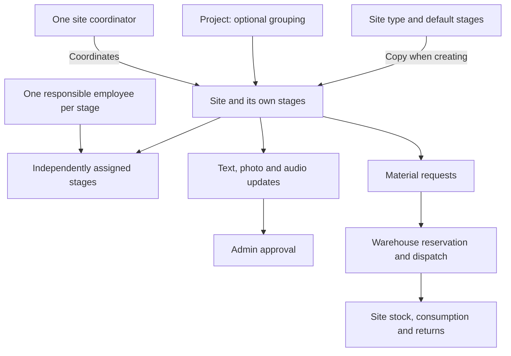
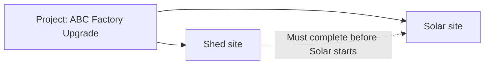
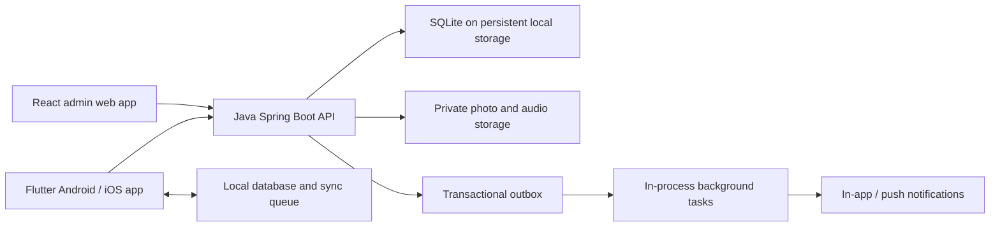

# Work Site Tracking System — Product and System Design

Version: 0.3 · Date: 22 October 2026 · Status: Design draft; stage ownership model proposed

This document describes the proposed first release. Decisions explicitly confirmed in discussion are listed below. Other business rules are proposals, so they can be changed before implementation. No application or database has been implemented yet.

## 1. Purpose and confirmed scope

Give one manager a reliable view of work across sites, and give employees a simple mobile workflow for reporting progress, submitting evidence, and tracking materials, including when connectivity is unavailable.

| Area | Confirmed decision |
| --- | --- |
| Manager | One admin account, provisioned directly through a Python script; no registration |
| Manager application | React web application in English |
| Backend and database | Java Spring Boot backend with SQLite |
| Employee application | Flutter application for Android and iOS, with offline work and synchronization |
| Employee languages | English, Hindi, Gujarati; admin selects language when creating/editing an employee |
| Assignment | Stage assignment requested; proposed model: one site coordinator plus one responsible employee per stage, with unassigned work allowed |
| Employee eligibility | Multiple eligible site types per employee, selected by admin |
| Initial scale | Approximately 50 active sites and 20 employees |
| Site types | Configurable types, icons, and default stages with evidence requirements |
| Stage execution | Stages may run in parallel unless an explicit dependency prevents it |
| Completion | Employees or admin request stage completion; admin approval completes a stage; final stage approval automatically completes the site |
| Admin field actions | Admin can start work, add progress updates/photos, and submit stage completion or block requests |
| Progress updates | Text, photos, audio, or any combination; at least one content item required |
| Photo evidence | At least one photo for an evidence-required stage; camera or gallery allowed; device location mandatory when each site photo is added |
| Offline photo location | Capture location when the photo is added; preserve it during later automatic synchronization without requesting a fresh location |
| Employee passwords | Set and reset only by admin; employees never change passwords, including after first login |
| Linked sites | Group sites under a project, with optional dependencies between sites |
| Inventory | Track warehouse stock, site stock, consumption, and returns |
| Consumption and returns | Employee records consumption and requests returns; admin confirms returned stock received |
| Material requests | Multiple simultaneous requests allowed, including repeated requests for the same material |
| Fulfillment | Approval and physical dispatch are separate; provide an Approve & Dispatch shortcut |
| Work closeout | Material reconciliation remains separate after site completion |
| Daily reporting | Notes optional; reminders after a configurable cutoff on configured working days |
| Offline access | 7-day local unlock window after successful online authentication |
| Warehouse model | One warehouse; return and redispatch instead of an inter-site transfer UI |

### Proposed defaults awaiting review

- One organization in the first release.
- Business timezone: Asia/Kolkata. Dates such as “today” and due dates use this timezone.
- Overdue is a separate flag, so a site can be both Blocked and Overdue.
- Photo location accuracy/freshness thresholds, audio limits, and device-cache budgets are configurable; initial proposals are specified below.

### Revision 0.2 decisions

This revision confirms the Java Spring Boot / SQLite / React / Flutter stack, multiple employee site types, text/photo/audio progress updates, mandatory site-photo location, additional admin work/submission permissions, and admin-only employee password management. Previously proposed closeout, daily reporting, 7-day offline unlock, and single-warehouse rules are now confirmed rather than open questions.

### Revision 0.3: stage ownership and simpler interaction

The requested feature assigns each stage to a person. The design proposes keeping one site coordinator and one responsible employee per stage. Different people may own parallel stages at the same site. This revises the earlier one-employee-per-site assumption; the exact ownership and material-custody defaults remain proposed pending the optional clarification, not confirmed decisions.

The manager uses a compact stage register with a Person column and an inline picker. The employee sees their own work, one clear next job, and large photo/voice actions. Research, interaction rationale, resource budgets and validation plans are documented in [UI research and stage assignment](../design/specs/ui-research-stage-assignment.md).

## 2. Vocabulary and product model

| Concept | Meaning | Example |
| --- | --- | --- |
| Site type | Reusable work category and stage template | Solar, Shed |
| Project | Optional parent grouping related work sites | ABC Factory Upgrade |
| Site | An independently assigned and tracked work package | ABC Factory — Shed |
| Stage | A unit of work inside a site, with one current responsible employee | Foundation, Structure, Inspection |
| Site coordinator | Employee responsible for site context and material custody; not automatically owner of every stage | Ravi coordinates Solar |
| Stage owner | Employee responsible for one specific stage; assignment is independent of other stages | Neha owns Wiring |
| Dependency | A prerequisite that must be approved/completed before other work can start | Shed completed before Solar starts |
| Completion submission | An employee's or admin's request to approve a stage, with required photo evidence and optional text/audio context | Foundation photos submitted for approval |
| Progress update | Text, photos, audio, or a combination, attributed to the actual author | A Gujarati voice note with two site photos |
| Material request | A site's request for additional material | 20 panels requested |
| Reservation | Warehouse quantity committed to an approved request, still physically in warehouse | 20 panels reserved |
| Dispatch | Physical movement from warehouse stock to site stock | 12 panels dispatched |

Use **Site Types** for the configuration screen and **Sites** for actual work. This removes the ambiguity between the two “site” screens in the original description.

## 3. Roles and access

| Capability | Admin | Employee |
| --- | --- | --- |
| Manage types, templates, employees, materials | Yes | No |
| Create/edit/publish sites and projects | Yes | No |
| Assign/reassign coordinator or stage owner | Yes, including explicit bulk stage assignment | No |
| View site details | Every site | Coordinator: site context and stage history; worker: own stages plus minimal site/dependency context |
| View linked sites | Full details | Limited project context; full details only when assigned |
| Start work, add text/photo/audio progress updates | Every published incomplete site, subject to dependencies | Own stages only; coordinator may also add site-level notes |
| Submit stage completion/block requests | Every published incomplete site | Own stages; coordinator can request a whole-site block |
| Approve/reject completion or blocking | Yes | No |
| Set/reset employee passwords | Yes | No, including first login |
| Request material | Can create allocations | Coordinator or current stage worker; optional stage reference |
| Approve, reserve, dispatch material | Yes | No |
| Record consumption | Can correct through audited entries | Site coordinator (proposed custody default) |
| Request returns | Yes | Site coordinator (proposed custody default) |
| Confirm physical return received | Yes | No |
| Reopen a completed stage/site | Yes, with reason | No |
| View organization dashboard/audit history | Yes | Authorized site/stage activity only |

Every API call and evidence download must enforce role and current assignment on the server. Hiding a button does not enforce access. This follows [OWASP authorization guidance](https://cheatsheetseries.owasp.org/cheatsheets/Authorization_Cheat_Sheet.html).

Reassignment preserves authorship and history. Stage authorization changes immediately on the server; access to other currently assigned stages remains. Revoke full site access only when no coordinator/stage relationship remains. Stale queued operations are quarantined, not silently applied. Coordinator visibility never grants permission to start, submit or edit another person's stage; admin retains its explicit field permissions.

Admin work actions do not require assigning the admin as an employee and do not replace the current assignee. Attribute work, media, and requests to the admin who performed them. Work and evidence prerequisites apply to admin submissions as well. With one admin, an admin may approve their own submission, but submission and approval are separate explicit actions and audit events; submitting never silently approves it.

## 4. Manager web application

Navigation: **Dashboard · Sites · Projects · Approvals · Site Types · Employees · Materials · Settings**. Approvals combines stage completion, block requests, material requests, and return receipts, with counts and filters. Settings includes working days, reporting cutoff, reminders, and configurable operational limits.

### 4.1 Login and account provisioning

- One admin login identifier and password; no sign-up or public admin creation endpoint.
- Deliver `scripts/create_admin.py` during implementation against the versioned SQLite schema.
- The script prompts for an identifier and password using hidden password input. It uses a maintained Python Argon2id implementation and the exact encoded hash contract verified by Spring Security login.
- In one transaction, it checks that an admin does not exist and inserts the account. Enforce the single-admin constraint in the database as well.
- Re-running it must not overwrite an existing account or silently reset its password.
- Provide a separate explicit password reset command for recovery, with session revocation.
- The script will store an encoded password hash containing algorithm, parameters, unique salt, and hash. It will not print or log the password.

Use a maintained Argon2id password library with unique salts and deployment-tuned settings, consistent with [OWASP password storage guidance](https://cheatsheetseries.owasp.org/cheatsheets/Password_Storage_Cheat_Sheet.html). Do not implement password hashing manually.

Configure Spring Security's password encoder explicitly, including any stored algorithm identifier prefix; prove that hashes generated by the Python script authenticate through the Java application. See [Spring Security password storage](https://docs.spring.io/spring-security/reference/features/authentication/password-storage.html). The script uses an existing migrated database, enables foreign keys, verifies schema compatibility, and fails on a wrong/missing database path instead of silently creating an unrelated SQLite file.

### 4.2 Site Types

List/grid: icon, type name, number of default stages, active site count, active/archived status.

Detail page opens in read mode, with Edit and Save/Cancel. Add/Edit includes name, icon, and a dynamic ordered list of stages. Each stage has a name, evidence-required switch, display order, and optional predecessor stages. Display order does not imply a dependency. Prevent circular dependencies.

Saving a type changes the template for future sites. Existing sites keep a snapshot of their stage definitions. Archive types used by historical sites instead of deleting them.

### 4.3 Employees

List: name, mobile, eligible site types shown as chips, preferred language, coordinated site count, owned stage count, active/inactive. One search field matches name or normalized mobile number.

Add/Edit: name, mobile number with country code, **site types as a searchable multiple-select**, preferred language (English/Hindi/Gujarati), and password on creation or explicit admin reset. Require at least one active eligible site type. Phone numbers are unique login identifiers. Do not assume an India-only phone format unless confirmed.

The admin may view the newly entered password to share it with the employee, as requested. After saving, it is never returned by the server or shown on the detail page. The admin alone sets/resets employee passwords. Employees cannot change passwords at first login or later; there is no employee change-password screen or authorized API action. A reset invalidates server sessions and requires the new password at the next online login; an offline device learns of the reset only when it reconnects or its 7-day unlock window expires.

Assignment is allowed when a site's type is among the employee's eligible types. An employee may therefore hold Solar and Shed sites simultaneously, while each site has at most one current coordinator and each stage at most one current responsible employee. Removing a type that is used by an active assignment requires resolving both coordinator and stage assignments first; do not silently invalidate or unassign them.

Employee detail opens in read mode, showing coordinated sites and owned stages with clickable site name, type, status, overdue flag, due date, and project. Every site links to its detail page. Edit changes profile fields. Deactivation requires reassignment/unassignment of active coordinator and stage responsibilities and invalidates sessions; historical records remain.

### 4.4 Materials

Inventory list: photo, material name/code, unit, warehouse on-hand, reserved, available, and total stock at sites. Search by name/code.

Add material: name, photo, and **unit of measure**, such as pieces, kg, meters, or liters. Unit is required because quantities otherwise have no meaning. Use decimal quantities with configured precision; piece-based materials allow whole quantities only. Do not change a unit after movements exist.

Add stock: searchable material selector, quantity, receipt date, and optional reference/note. This creates a warehouse receipt transaction.

Material detail shows receipt history, reservations, dispatches, consumption, returns, and audited adjustments. Movement rows show time, quantity, source/destination, actor, reference, and clickable site. Stock totals and movement history must reconcile.

### 4.5 Sites

List columns: site name/code, type, project, coordinator, district, workflow status, overdue, approved stage count, due date, last employee update, pending approvals, and open material requests.

Filters combine with AND; multiple values within one filter combine with OR:

- Name/code search; site type/category; project.
- Expected completion within the next N calendar days, inclusive of today; overdue is a separate filter.
- Workflow status; coordinator; stage owner, including unassigned stages; district. Coordinator and stage-owner filters have distinct labels.
- Open material request, optionally matching a material.
- Updated today / no employee update today.

Add/Edit site fields:

| Field | Rule |
| --- | --- |
| Site type | Required searchable dropdown; locks after publishing |
| Name/code | Name required; generated unique code |
| Project | Optional existing project or create project |
| Location | Address, district, state; coordinates optional |
| Expected completion date | Required to publish; date interpreted in business timezone |
| Site coordinator | Optional searchable dropdown filtered to active employees eligible for the site type |
| Stages | Copy type defaults; add/remove/reorder, evidence/dependencies and an explicit person per stage; optionally copy coordinator to selected stages |
| Initial materials | Searchable material and quantity lines; planned until explicitly dispatched |
| Notes | Optional instructions |

Actions: Save Draft, Publish, Assign/Reassign, Edit, Start work, Add progress update, Add photo, Request stage completion, Request block, Block/Unblock with reason, and Reopen with reason. Admin updates support text, photos, audio, or a combination. Publishing requires at least one stage, valid dependencies, and required fields. Drafts remain invisible to employees and do not reserve or dispatch stock.

Initial material lines are allocations, not automatic stock deductions. At publishing, the admin can dispatch selected quantities or fulfill them later. The UI states exactly which action moves stock.

Site detail tabs: **Overview · Stages & Evidence · Materials · Linked Sites · Activity**. Place pending actions near the top; material requests can be approved or declined directly here. A sticky header shows coordinator, due date, progress, workflow status, and overdue/dependency indicators. Default is read mode with an explicit Edit action.

Media viewers include photo location details and audio playback. Work actions remain available in read mode when permitted; changing site configuration still requires Edit. An admin can start an unassigned published site without creating an employee assignment; it then derives In Progress from recorded work.

After work starts, stage changes need safeguards. Pristine stages may be added/removed with an audit entry; removing a predecessor requires resolving dependencies first. Stages with activity, evidence, submissions, or approvals cannot be silently deleted. Completed sites require explicit reopening before work structure changes.

### 4.6 Projects and linked sites

A project groups two or more sites of any types; grouping is optional for standalone sites. Project detail shows a shared summary, site cards, dependency diagram, and aggregate progress. Creating a project may start with one site and add more later.

Example:

Each site retains its own coordinator, stage owners, stages, due date, evidence, stock, and requests. Grouping does not merge inventory or transfer material automatically. A project may supply location defaults, but each site stores its actual location.

An optional site dependency means “predecessor site must be Completed before dependent site work starts.” Material planning/requests can happen while waiting. Stages have analogous dependencies on approved predecessor stages. Prevent self-dependencies and cycles; initially restrict site dependencies to sites in the same project.

A dependency hold is shown as **Waiting for Shed** and counted as a blocker, while preserving whether the site is Assigned or In Progress. Completion of the predecessor removes the hold; it does not start the next site automatically.

If a completed predecessor is reopened after downstream work has started, do not roll back downstream history. Add a dependency hold to unfinished downstream work and require admin review. Do not retroactively un-complete a downstream site; flag the inconsistency for admin review.

Removing a site from a project requires resolving its dependencies. Linking itself grants employees no access to other employees' evidence or material records. A linked-site summary exposes only name/type, relevant completion status, and dependency reason.

## 5. Workflow rules

### 5.1 Stage work and approval

Keep work status and review status separate:

| Field | Values |
| --- | --- |
| Stage work status | Open, In Progress, Blocked, Completed |
| Latest submission review | None, Pending, Approved, Changes Requested |

The current owner of a stage, or the admin on any published incomplete site, starts a stage when prerequisites are satisfied, adds text/photos/audio, and selects **Request completion**. Submission from an untouched stage also records work as started. Submission is allowed without photos when evidence is not required. Audio and text never substitute for a required photo; each photo must satisfy the location and upload rules in section 7.4.

A request creates a numbered, immutable submission with its own evidence references. While review is Pending, stage work stays In Progress and the UI shows Awaiting approval. Allow only one pending completion submission per stage. New general photos do not change an already submitted evidence set.

Admin approval changes the stage to Completed. Rejection requires a reason, changes review to Changes Requested, and leaves work In Progress. Resubmission creates a new attempt; earlier decisions and evidence remain visible. Employees cannot edit an approved stage. Admin reopening requires a reason and invalidates its current completion without deleting its history.

At final approval, the server verifies the submission version, dependencies, required evidence, and any active block. Approving while blocked requires an explicit unblock action first. Admin batch approval may be supported, but validates every stage individually.

### 5.1a Assignment and handover contract (proposed defaults)

- One active coordinator per site and one active employee owner per stage. Admin is not an employee assignee. An employee must be active and eligible for the site's type for either role. Site-type templates contain no employee IDs.
- Creation offers an explicit “Use coordinator for these stages” action. It writes independent stage assignments; there is no dynamic fallback. New stages remain Unassigned unless admin chooses an owner. A coordinator change never moves existing stages silently.
- Manager stage rows show stage name, Person, evidence/dependency and status. Click Person to search eligible employees; show each person's open-stage count as context, not an automatic capacity prediction. Keyboard search, Escape, focus return and visible selection are required. Bulk assignment uses explicit selected stage IDs and a preview count; it changes neither dependencies nor progress.
- Reassignment of started work requires a reason and warns about accepted pending submissions and offline changes. Preserve authorship, photos, location, decisions and timestamps. Previously accepted pending submissions remain reviewable; their author is immutable. A new owner cannot rewrite that attempt. Changes Requested permits a new attempt from the current owner. Completed stages retain historical ownership and cannot be reassigned without reopening.
- Assign/reassign validates expected stage and assignment versions atomically. Bulk changes are all-or-nothing; a conflict reports affected stages without partially applying the selection. Reject inactive/ineligible employees and stale versions. Stage ownership never bypasses blocks or dependencies.
- Unassigned work is visible in the manager's “Unassigned stages” filter. Publishing with unassigned stages is allowed and warned; an employee cannot start them. Admin may perform permitted work on them. The manager can resolve assignment without changing the coordinator.
- Notify new and former owners once after commit. Update My work using assignment deltas; exclude drafts and revoked work. Never hide assigned work merely because it has no due date or is waiting for a prerequisite. Reminder recipients follow currently assigned unfinished stages; one deduplicated daily reminder per employee, with coordinator escalation optional.
- Site-level materials remain a single balance. Proposed default: all current stage workers may request material; only coordinator/admin records consumption or initiates returns. A worker without a coordinator sees “Ask manager about material use”, rather than gaining implicit custody. Coordinator permissions for material reconciliation continue after work completion until explicit release. No double counting when one employee holds both roles.
- Every offline stage operation carries stage ID, stage version and stage-assignment ID/version; site-level custody operations also carry coordinator-assignment version. Download assignment deltas before replay. An operation from a revoked assignment is quarantined even if the same employee is assigned again later. Recovery is admin-assisted, preserves the original payload/author/location and never silently impersonates the new owner.
- A coordinator sees site-wide stage evidence for coordination; a stage worker gets their own stage evidence, necessary instructions, due date, site stock and a minimal prerequisite summary. Coworker media, phone numbers and private notes are excluded. A worker's general note/photo must target an owned stage. Every list, sync payload, media URL and mutation enforces this projection server-side.

### 5.2 Blocking

- Admin may block a published incomplete site or stage, with a reason, at any workflow point.
- Employee or admin may request a site or stage block, with reason and optional evidence; the request itself does not change the official status. Admin may alternatively use the direct Block action.
- Admin approves or declines, with the decision recorded. The UI prominently shows pending block requests even before approval.
- Whole-site blocks prevent stage starts and completion submissions. Evidence, notes, and material requests remain available to explain and resolve the issue.
- A blocked individual stage leaves independent stages available to work. Its dependencies remain held until it completes.
- Unblocking clears that block and recomputes status; it does not reset stage progress or clear unrelated blocks/dependencies.
- Completed work can be blocked only after explicit reopening. Drafts are editable preparations; blocking applies after publishing.

### 5.3 Derived overall site status

The backend owns status derivation; clients do not send arbitrary overall status changes.

Apply these rules in order:

| Condition | Workflow status |
| --- | --- |
| Not published | Draft |
| All active stages completed, with at least one active stage | Completed |
| Whole-site admin block or at least one blocked stage | Blocked |
| Any work has started, including a pending completion submission | In Progress |
| Published, no work started, coordinator or at least one stage owner exists | Assigned |
| Published, no work started, no coordinator and no stage owners | New |

Normal path: Draft → New → Assigned → In Progress → Completed. Publishing with a coordinator or stage owner goes directly to Assigned. Coordinator/owner changes do not change progress. Blocking overlays incomplete work; unblocking returns to the derived status. Reassigning/unassigning an already started site never resets it to New. Reopening Completed returns to the derived incomplete status.

**Overdue** is `published AND incomplete AND expected_completion_date < business_today`. It is derived at read time rather than maintained by a midnight job. A site due today becomes overdue tomorrow. Show, for example, **Blocked · Overdue 3 days**. The requested Overdue filter remains available across all incomplete statuses. Record whether a completed site finished late separately.

`approved_progress = approved active stage count / active stage count × 100`.

All stages have equal weight initially. Awaiting approval is shown separately and does not count as approved progress. A project uses the combined approved/total stage counts across its published member sites; show drafts separately. Project completion requires at least one published site, all published sites completed, and no remaining draft member sites.

The last stage approval completes the site atomically. A site-level Request completion shortcut, if included, submits remaining eligible stages individually; it cannot bypass evidence, dependencies, or per-stage approval.

## 6. Material lifecycle and inventory correctness

### 6.1 Quantities and movements

For each material:

- `warehouse_on_hand = receipts + confirmed_returns + net_adjustments - dispatches`.
- `warehouse_available = warehouse_on_hand - active_reservations`.
- `site_on_hand = dispatches_to_site - consumption - confirmed_returns - recorded_losses + net_site_adjustments`.
- `site_available_to_consume = site_on_hand - pending_return_quantity`.

Confirming a return reduces site on-hand and increases warehouse on-hand in the same transaction. Pending return quantities remain in site on-hand, visibly marked committed to return, and cannot also be consumed. Partial receipt leaves the remainder pending; cancelling the remainder releases that quantity. Damaged/lost material uses an explicit adjustment/loss entry and reason; it never becomes warehouse stock.

Use an append-only movement ledger with a transaction header and location-level entries. Dispatches and returns have paired source/destination entries. Correct mistakes through linked reversal/correction transactions instead of editing history. Reject negative balances and invalid decimal precision. With SQLite, serialize short write transactions and use conditional balance/version updates; do not assume row-level locks. Reservation, balance, ledger, request, audit, and outbox changes commit together. Section 10.1 defines the concurrency policy.

Represent stock quantities as scaled integers using each material's fixed precision, and use exact decimal conversion at API boundaries. For example, 1.250 kg with precision 3 is stored as 1250 base units. Do not store stock quantities as binary floating point; this preserves exact reconciliation in SQLite.

### 6.2 Requests, approval, reservation, dispatch

1. Employee submits one or more material lines with quantities and a note. Multiple open requests are permitted.
2. Admin approves quantities, partly approves, or declines, with a reason for reductions/declines.
3. Approval reserves available warehouse stock. If stock is insufficient, reject that reservation attempt or approve only what is available; leave remaining demand pending with an explanation.
4. Admin records physical dispatch, optionally in multiple batches. Each batch consumes its reservation and moves that quantity to site stock.
5. Approve & Dispatch performs reservation and dispatch together in one transaction when goods leave immediately.
6. Employee sees requested, approved, reserved, dispatched, consumed, returned, and remaining site quantities separately.

Line quantities determine request status: Pending, Partially Approved, Approved, Partially Dispatched, Fulfilled, Declined, or Cancelled. Partial approval is not a terminal decision: every residual quantity must be pending, declined, or cancelled explicitly. Show mixed outcomes per line instead of relying only on the header label.

Cancelling undelivered quantities releases reservations. Dispatched quantities cannot be cancelled; use a return. Returns do not automatically reopen a fulfilled request. No request is overwritten when another request for the same material arrives; show an informative duplicate-demand warning while allowing submission.

### 6.3 Consumption and returns

Employees record material, quantity, date, and optional stage/note. Server acceptance immediately updates site stock; admin approval is not required. Employees cannot modify accepted consumption events; corrections are auditable admin reversals/corrective entries.

Employees request returns from available site stock. Admin confirms actual quantity received, allowing partial receipts and recording discrepancies. Stock is not added back to warehouse merely because a return was requested.

Work completion and material reconciliation are separate, as confirmed. Completed sites still permit closeout returns and admin corrections, but new requests/dispatches/consumption require reopening. Pending material demand is highlighted for admin cancellation/review. Surplus awaiting collection does not prevent the final stage approval from completing a site.

## 7. Employee Flutter application

Navigation: **My work · Messages · Help**. Help contains language, profile and sending status. Daily actions stay within the site workspace; detailed lists are secondary.

### 7.1 Login and language

Login with mobile number and admin-provided password. First login requires connectivity and goes directly to My work; no password-change step. Recovery directs employees to admin. Language defaults to the employee profile; login also offers English/Hindi/Gujarati. Employees may change their interface language from Help. Translate labels, errors and notifications; business-entered names and notes remain as entered. Full linguistic and screen-reader testing is required before release.

### 7.2 Home and site detail

My work groups owned unfinished stages by site, including waiting work and work without dates. Each entry uses a recognizable site illustration/thumbnail, name, short location, next owned job and one Open action. Coordinated sites without owned stages remain available as “Site materials”, without inventing a Start action. Search and a simple status filter remain available.

Site opens to the next actionable **owned** stage, with Start work or This work is done, plus Add photo and Voice note. The next job prioritizes Changes Requested, then In Progress, then ready Open work, using stage order as tie-breaker. If every owned stage is waiting, show why and offer notes/material request, without another worker's task action. If several are ready, the labelled My jobs action opens the short own-work list. It takes two taps from home to starting a ready task or opening photo/voice/material request.

Use structured rows for the employee's own stages under “My jobs here”; no stage-card dashboard or assignment controls. Show read-only prerequisite context when needed. Photos/voice can send without a caption. Explicit confirmation says Saved on phone, Sent for checking, or Approved as appropriate. Materials remain a site-level secondary view; worker-only view offers Request material and request history, while coordinator view adds Record use and Return material.

Use everyday words, icons with labels, 18sp primary body copy, 64dp main controls and at least 48dp other mobile targets. The 64dp target is our field-use design choice. Preserve layout with text scaling and Android/iOS safe areas; flat fills and separators replace decorative effects. Real device testing must verify this prototype's intended semantics and accessibility.

### 7.3 Offline and synchronization contract

Use a local database behind repositories that expose cached site data and synchronize with the API. This architecture follows [Flutter's offline-first guidance](https://docs.flutter.dev/app-architecture/design-patterns/offline-first). The conflict and approval rules below are specific to this application.

| Action | Offline behavior |
| --- | --- |
| Read assigned sites/stages/materials | Previously synchronized data available; show last sync time |
| Add text/audio updates, start stage | Save locally and queue; server must still validate on sync |
| Add site photos | Obtain required device location at addition, persist it with the photo, then queue both; automatic sync preserves this observation |
| Request completion/block/materials/return | Queue as a pending submission; not officially submitted until server accepts |
| Record consumption | Queue locally; show provisional balance separately from confirmed stock |
| Login to a new device, reset password, admin actions | Connectivity required |

Every local mutation has a stable UUID operation ID. The server deduplicates retries by authenticated actor and operation ID and rejects reuse with a different payload. Local success means Saved on device; server success means Submitted/Synced. Never display an offline completion request as Approved or Completed.

Persist the local change and its queue entry together. Upload photo/audio attachments first, validate/finalize them, then submit the update or completion with accepted media references. A site photo's location observation is saved atomically with its local attachment and travels with it unchanged. Do not replace that observation with the device's later synchronization location or request fresh location merely to retry an upload. Failed uploads preserve local drafts. Support retry with backoff, manual Sync now, progress, and error explanations. Synchronize on app launch/resume and connectivity recovery; background execution is best effort and must not be the sole delivery mechanism.

Use server entity versions for mutable actions. Fetch assignment changes and deletion/archive markers before replaying work. Preserve dependent operation ordering, such as stage start before submission. Revalidate assignment, block state, dependencies, evidence, and stock at server acceptance. A stale consumption entry that exceeds available stock becomes a visible conflict rather than forcing stock negative.

Additive notes can merge when access remains valid; approval, workflow, inventory, and template changes never use blind last-write-wins. Conflicts retain the employee's local input and explain the resolution required. If reassigned while offline, quarantine rejected unsynced work and provide a controlled admin-assisted recovery path instead of deleting it silently.

Store photo-added time, the device location observation time, any separately available original camera capture time, and server receipt time independently. Do not infer a gallery photo's original shooting location from the uploader's position. Device clocks do not determine official approval times or “updated today” dashboard counts. The app should show that work recorded yesterday arrived today when relevant.

After successful online authentication, allow local unlock for 7 days using device-protected credentials, as confirmed. Offline use alone does not extend the window. At expiry, require an online login before unlocking site data or submitting more work; retain unsynced drafts for recovery after authentication. Offline unlock does not create a new server session or bypass current server authorization on reconnect. On the next successful sync after reassignment/deactivation/password reset, enforce the current session/assignment state; purge revoked cached records and downloaded media while quarantining unsynced work for recovery. Previously cached data cannot be remotely removed while the device remains disconnected. Logout clears account data and warns about unsynced work before discarding it.

Proposed initial device budgets: 500 MB for downloaded media cache, with least-recently-used eviction, and a separate 500 MB queue budget for unsynced photo/audio attachments. Keep assigned-site metadata while authorized. Never automatically evict pending work to free cache space. At the pending-media limit or insufficient device free space, stop accepting additional media with a clear message and retain existing work; text updates remain possible when storage permits. Cache/media retention durations and these configurable limits need confirmation before implementation.

### 7.4 Mandatory location for site photos

Location is mandatory for every photo attached to site progress, stage completion, or site/stage block evidence, whether the author is an employee or admin. Catalog material photos and site-type icons are outside this field-evidence rule. Text-only or audio-only updates do not require location; adding a photo invokes the photo rule.

1. When the user takes or selects a photo, explain why location is needed, request location permission if it has not been granted, and obtain a fresh device position. Existing permission may be reused; the operating system need not show a permission prompt for every photo.
2. Require location services and a successful fix before the photo becomes an accepted attachment. If permission is denied, services are disabled, or a fix times out, show retry/settings actions. Preserve any local selection as an unfinished draft; do not queue it as valid location-backed evidence or invent a position.
3. Save each photo's latitude, longitude, horizontal accuracy in meters, location-observed time, photo-added time, uploader, device/client identifier, and reported provider/source when available. Save an available original capture timestamp separately. This metadata is immutable after attachment acceptance.
4. For offline additions, acquire location from device location services and save the photo plus observation locally. GPS can obtain a fix without an internet connection when conditions allow; if no fix can be obtained, the photo remains an unfinished draft. Location is observed when successfully attached, not backdated to a failed earlier attempt.
5. During later automatic upload/sync, submit the saved observation unchanged. Record server receipt time separately. No new GPS fix or location permission is required merely for transport, so movement between addition and synchronization does not change the recorded location.
6. The server checks required metadata, valid coordinate ranges, nonnegative finite accuracy, media association/ownership, and idempotent upload completion. Missing or malformed location makes photo finalization fail and prevents it satisfying evidence-required completion. Flag inconsistent device timestamps for review rather than rewriting them as trusted server time.

Proposed initial freshness setting: obtain an observation no more than 60 seconds old when adding a photo; request high accuracy and record the result. The acceptable accuracy threshold and low-accuracy behavior remain to be agreed. A shared fresh observation can be linked to each image in one selection batch; later additions obtain a new observation. Do not use the site's configured address, IP-derived server location, or gallery EXIF as a substitute for the uploader's live device position.

The photo viewer shows **Added at [location/time]**, reported accuracy, author, and **Synced at [server time]**, with an optional map link. It does not label uploader position as the photo's original shooting location or imply verified physical presence. On the React admin web app, obtain device position over HTTPS using browser geolocation and its permission flow. Browser geolocation exposes device position but does not guarantee a hardware-GPS source; review compatibility if literal satellite-only GPS is required. See the [W3C Geolocation specification](https://www.w3.org/TR/geolocation/).

Capture location only for explicit photo-add actions. Do not request continuous background tracking for this workflow. Access to photo coordinates follows the same site authorization as the photo itself.

### 7.5 Text, photo, and audio progress updates

Provide one progress composer in Flutter and the admin web app. An update can contain text only, photos only, audio only, or any combination. Require at least one nonempty text field or successfully finalized attachment; no mandatory text caption. Associate the update with a site and optionally a stage, and record its actual author/role and device/server times.

The composer supports taking/selecting photos, recording/listening to/deleting draft audio, and reviewing attachments before submission. Ask for microphone permission when recording; denial prevents recording without preventing text/photos. Audio can contain speech in English, Hindi, Gujarati, or any language; playback is provided without automatic transcription or translation in this release.

Store audio in private media storage, validate allowed types and decoded duration, and show playback controls/duration in both applications and the activity timeline. Proposed initial audio limit: 5 minutes and 10 MB per clip; audio container/codec and limits remain configurable pending Flutter/browser compatibility testing. Audio attachments never count toward a required-photo rule.

Text and media references belong to one logical update. Save drafts and media upload states durably; publish the update only when its selected attachments are accepted, with retry or explicit removal of failed draft attachments. Network retries must not duplicate the update or its photos/audio. Accepted content is preserved with audit history; draft deletion before submission is allowed.

## 8. Dashboard definitions

Use rule-based operational intelligence first. Every metric links to the corresponding filtered site list. Show the business date, timezone, and last refresh.

| Metric | Definition |
| --- | --- |
| Active sites | Published and incomplete sites; excludes drafts and archived completed history |
| Progress by site type | Per-type count by workflow status plus approved/total active stages |
| Blocked sites / total active | Distinct active sites with manual, stage, or dependency blocks / active sites |
| In Progress / total active | Active sites whose derived workflow status is In Progress / active sites |
| Overdue | Active sites with expected completion before business today, regardless of other status |
| No update today | Currently In Progress sites with no qualifying employee activity received today |
| Updated today | Currently In Progress sites with at least one qualifying employee activity received today |
| Waiting for admin | Pending completion submissions, block requests, material decisions, and return receipts |
| Material attention | Low available warehouse stock, unfulfilled approvals, pending returns, unreconciled completed sites |

A qualifying employee update is an accepted text/photo/audio progress update, accepted photo, stage start/submission, block request, material request, consumption, or return request. Logins, opening a site, synchronization without changes, and admin actions do not count toward the employee-reporting metric. A rejected sync operation does not count. Offer a narrower work-progress-only filter if material activity should not count as progress reporting.

Store/display last work activity (employee or admin) separately from last employee activity. Admin work updates are visible on the site and can change workflow/progress; they do not make an employee appear to have reported. Label employee-reporting dashboard cards and filters explicitly, and offer an actor filter for operational activity views.

“No update today” means no update received yet; before the configured end-of-day cutoff it is not a missed obligation. Daily notes are optional. Admin configures working days, reporting cutoff, reminder recipients, and reminder enablement in Settings. Send reminders only on configured working days for eligible In Progress sites with no qualifying employee update, deduplicated per site/date/reminder. Do not assume working days from language or location; require the admin to save the calendar/cutoff before scheduled reminders are enabled. A reminder creates no mandatory daily-submission requirement.

Workflow counts form one breakdown; overdue and blocker overlays may overlap it and must be labeled accordingly. Projects never add to site totals. A separate project summary prevents double counting linked work. Record due-date changes and prior due dates so rescheduling does not erase history.

## 9. Logical data model

| Entity | Important fields and constraints |
| --- | --- |
| User | ID, role ADMIN/EMPLOYEE, login identifier, encoded password hash, active, credential/session version; single-admin constraint; no employee password-change flag |
| EmployeeProfile | User ID, name, normalized unique mobile, preferred language |
| EmployeeSiteType | Employee ID, site type ID; unique pair; multiple types per employee |
| SiteType | ID, name, icon reference, active, template version |
| StageTemplate | Type ID, stable key, name, evidence required, display order |
| TemplateStageDependency | Predecessor/successor template stage IDs; acyclic within type |
| Project | ID, code, name, optional location defaults, description |
| Site | ID/code, name, type ID, source template version, optional project ID, address/district/state, due date, published time, first-started time, completed time, version |
| SiteAssignment | Coordinator relationship: site ID, employee ID, assignment version, assigned/unassigned times, actor/reason; unique active coordinator per site |
| StageAssignment | Stage ID, employee ID, immutable assignment ID/version, assigned/unassigned times, actor/reason; unique active owner per stage, historical rows retained |
| SiteStage | Site ID, copied name/evidence requirement/order, work status, active, started/approved times, version |
| StageDependency | Predecessor/successor site stage IDs; acyclic within site |
| SiteDependency | Predecessor/successor site IDs, created by/time; acyclic within project |
| ProgressUpdate | Site/optional stage ID, author ID/role, optional text, local operation ID, recorded/received times; at least one content item |
| MediaFile | Site/optional stage ID, uploader, media kind PHOTO/AUDIO, object key, content type/size/checksum, optional audio duration, original capture/added/received times, validation state |
| ProgressUpdateMedia | Update ID, media ID, display order; photo/audio attachments belonging to one update |
| PhotoLocation | Photo media ID, latitude/longitude, accuracy, observed time, added time, reported source, device/client ID; required per site photo and immutable across retries |
| StageSubmission | Stage ID, attempt number, submitter, review status, stage version, accepted assignment ID/version, decision actor/time/reason |
| SubmissionEvidence | Submission ID and immutable photo media references; validated photo location required |
| SubmissionContextMedia | Submission ID and optional audio context references; audio is not photo evidence |
| BlockRequest / BlockRecord | Site/optional stage, reason, requester/approver, request decision or active/resolved block timestamps |
| Material | ID/code, name, photo, unit, quantity precision, active |
| StockLocation | Warehouse or site; site link when applicable |
| MaterialAllocation | Planned site material quantities created by admin; no physical movement |
| MaterialRequest / Line | Site, requester, note; material, requested/approved/declined/cancelled quantities |
| Reservation | Request/allocation line, warehouse, quantity, fulfilled/released quantities, version |
| Dispatch / Line | Site, warehouse, material/quantity, source request/allocation and reservation, actor/time |
| Consumption | Site/material/stage, quantity, employee, captured/received time, operation ID |
| ReturnRequest / Line | Site, material, requested/received/cancelled quantities, employee/admin actions |
| StockMovement / Entry | Type/reference/reversal link and actor; material, location, signed quantity |
| StockBalance | Transactionally maintained/rebuildable quantity by material/location |
| AuditEvent | Actor, action, target, before/after metadata, reason, server time, correlation ID |
| Notification / OutboxEvent | Recipient/event, localized message parameters, delivery/read state |
| DeviceSession / SyncOperation | Device/session, token state; operation ID, stage/coordinator assignment IDs and versions, payload fingerprint, outcome, timestamps |
| ReportingSettings | Timezone, working days, cutoff, reminder enabled/recipients, operational media/location/cache limits |

Core invariants belong in database constraints and transactions as well as application validation: one admin, one current coordinator per site, one current owner per stage (partial unique indexes on active assignment rows), unique phone, unique employee/type membership, one pending completion submission per stage, positive scaled-integer movement quantities, valid quantity precision, nonnegative usable stock, and unique operation IDs. Validate assignment type membership, nonempty progress content, required finalized photo/location relationships, dependency cycles, and state transitions in the transactional service layer. Keep photo-location metadata and media finalization in one transaction so an accepted site photo cannot exist without its required observation.

Archive referenced types, employees, and materials. Preserve workflow, evidence, and inventory history; decide retention before production. Store all event timestamps in UTC and convert at the interface; expected completion is a business-local date.

## 10. Architecture and API boundaries

Confirmed stack: **Java Spring Boot backend · SQLite database · React admin web app · Flutter Android/iOS app**. Use one modular backend instance, a persistent local SQLite database, private photo/audio storage, and in-process scheduled worker tasks for notifications/media processing. Validate the design against the expected 20 employees, 50 active sites, and bursts of offline sync before launch.

Backend modules: Identity, Configuration, Projects/Sites, Workflow/Approvals, Inventory, Media/Location, Sync, Reporting, Notifications/Audit. Workflow and inventory updates share transaction boundaries where needed. Hosting provider, supported framework/runtime versions, React UI tooling, Flutter storage/state-management packages, map presentation, and audio/location packages remain implementation selections; the main stack is settled.

### 10.1 Spring Boot and SQLite deployment contract

Use Spring Security for authentication/authorization and Spring JDBC with explicit SQL repositories for SQLite persistence. [Spring JDBC](https://docs.spring.io/spring-framework/reference/data-access/jdbc/core.html) provides JDBC query/update and resource handling; use a maintained [SQLite JDBC driver](https://github.com/xerial/sqlite-jdbc) and versioned SQL migrations. Do not assume an ORM supplies SQLite-compatible locking or schema behavior without verification.

SQLite permits multiple readers but only one simultaneous write transaction. WAL allows readers and a writer to operate concurrently; it does not introduce parallel writers. Keep the database on persistent local storage attached to the backend host, not a shared network filesystem. See [SQLite transactions](https://sqlite.org/lang_transaction.html) and [SQLite WAL](https://sqlite.org/wal.html).

Application design rules:

- Run one Spring Boot application instance with in-process jobs; route API and worker mutations through one write coordinator. Multiple employees still use the API concurrently; database write sections are short and serialized.
- Enable WAL, configure a bounded busy timeout, and use a write transaction that acquires write intent before read-modify-write checks where needed. Integrate this with Spring's transaction management rather than issuing nested `BEGIN` statements inside an existing transaction.
- Use conditional version/balance updates and verify affected rows. Commit the stock ledger, balances/reservations, request state, audit event, sync result, and outbox event atomically. On known rollback from lock contention, retry the complete transaction with bounded backoff; use stored operation IDs to recover uncertain responses without posting duplicates.
- Perform photo/audio transfers, device-location acquisition, media decoding, and notification network calls outside database write transactions. Finalize references and metadata in a short transaction after validation.
- Enable `PRAGMA foreign_keys = ON` for every application, migration, and Python-script connection. SQLite foreign-key enforcement is connection-specific; see [SQLite foreign keys](https://sqlite.org/foreignkeys.html).
- Use scaled integers for stock, checked conversions at the API boundary, foreign keys, unique/partial indexes, and checks for core invariants. Keep SQL portable where practical and maintain explicit schema versions.
- Pin compatible, patched Spring/JDBC/SQLite dependencies and record the SQLite version actually bundled by the driver. Exercise lock contention, concurrent final approvals, request retries, and interrupted sync against that exact runtime.
- Back up through a consistent SQLite backup mechanism, such as the [online backup API](https://sqlite.org/backup.html), rather than copying only a live main database file while WAL data may exist. Back up referenced private media as well and test restoration.

Monitor busy/locked responses, transaction duration, pending operations, disk space, database/media growth, and backup success. Horizontal backend replicas and multi-host database access are outside this first-release deployment contract; revisit the persistence architecture before introducing them. SQLite on the server is authoritative; Flutter's separate local database is a cache and operation queue accessed only by that device.

### 10.2 API and synchronization boundaries

Use versioned APIs, paginated lists, validated filters, consistent permission checks, structured error codes, idempotency keys, and explicit actions rather than generic status patches. Return server-derived status/progress/action availability for consistent clients.

Representative API surface, not a finalized OpenAPI specification:

| Area | Example endpoints |
| --- | --- |
| Auth | `POST /v1/auth/login`, `/refresh`, `/logout`; no employee change-password endpoint |
| Configuration | `/v1/site-types`, `/employees`, `/materials` |
| Credentials | `POST /v1/employees/{id}/password-reset`, admin-only; employee requests are rejected |
| Sites/projects | `/v1/sites`, `/projects`, `/sites/{id}/publish`, `/assign`, `/dependencies` |
| Ownership | `PUT /v1/sites/{id}/coordinator`, `PUT /v1/stages/{id}/assignment`, `POST /v1/sites/{id}/stage-assignments/bulk`; admin-only, expected versions and reason |
| My work | `GET /v1/me/work`; server-filtered owned stages and coordinated sites, minimal context; no coworker media |
| Work | `/v1/stages/{id}/start`, `/submissions`, `/sites/{id}/updates`, `/block-requests` |
| Reviews | `/v1/submissions/{id}/approve`, `/reject`, `/stages/{id}/reopen` |
| Stock | `/v1/stock-receipts`, `/material-requests`, `/reservations`, `/dispatches`, `/consumption`, `/return-requests`, `/return-receipts` |
| Media/location | `/v1/uploads/initiate`, `/uploads/{id}/finalize` with media kind and required site-photo location; authorized downloads |
| Settings | `/v1/settings/reporting` for working days, cutoff, and reminders; admin-only |
| Reporting/sync | `/v1/dashboard`, `/approvals`, `/sync/changes?cursor=…`, `/sync/operations` |

Sync changes are scoped to the employee, with assignment-revocation markers and a durable cursor. Each submitted operation has an individual result, so one conflict does not lose unrelated work. Photo/audio binaries use upload endpoints; their references and photo-location metadata travel in sync JSON. The backend accepts an otherwise valid offline photo observation that predates receipt; it does not require a new location observed during transport.

Notifications cover assignments, reassignment, review decisions, material decisions/dispatches, new pending approvals, and dependency release. In-app state is authoritative; push is a prompt to refresh. Avoid sensitive details in lock-screen notifications.

## 11. Security, reliability, and service targets

- Web: protected session cookies, CSRF protection, and TLS. Mobile: revocable sessions with short-lived access credentials and securely stored refresh credentials. Rate-limit login and use generic login failure messages.
- Java employee-password operations use one Spring Security hashing service; the Python admin script follows its verified encoded-hash contract. Employee callers cannot set/reset their own passwords through profile updates or credential endpoints. Never return stored hashes or include credentials in audit events.
- Photos, audio, and photo coordinates are private site data. Authorize uploads/downloads, constrain allowed formats/size/dimensions/duration, validate content, use generated object keys, and process files before finalization. See [OWASP file upload guidance](https://cheatsheetseries.owasp.org/cheatsheets/File_Upload_Cheat_Sheet.html).
- Proposed initial photo limit: 10 MB per source photo; compress suitable mobile captures and preserve readable evidence. Camera or gallery is allowed, but valid live device location at addition is mandatory for every site photo, including optional photos on evidence-optional stages. Store observed accuracy and timing; neither EXIF nor submitted coordinates alone prove original shooting location or physical presence. Do not request continuous background location access for later sync.
- Approvals, inventory postings, and resulting domain events commit atomically. Publish notifications through a transactional outbox so a notification failure cannot undo or lose an approved action.
- Audit assignment, due-date and stage changes, decisions, password resets, inventory corrections, and reopening. Do not log plaintext passwords, tokens, or private signed URLs.
- Keep SQLite and private-media backups aligned, protect database files and secrets, monitor failed jobs/sync errors, and verify restoration before launch.
- Proposed measurable targets, to validate during implementation: normal list/detail API p95 below 1 second at expected load, excluding media; local cached screens usable without network; durable recovery of queued work after app restart; nightly backups with a documented recovery procedure. Recovery point/time targets and production availability commitments remain to be agreed.

### 11.1 Proposed UI resource budgets

Treat these as implementation acceptance targets, not measurements of the static prototype: Flutter profile/release builds on a named entry-level Android device, warm cached screen usable within 300ms, p95 build and raster frame times each below 16ms at 60Hz during core scrolling, no full-resolution image decoded for a list thumbnail, no continuous location tracking, and no network requirement for cached work. Measure cold start, memory and battery on the agreed device before fixing hard limits. React targets: LCP ≤2.5s, INP ≤200ms, CLS ≤0.1 at the 75th percentile, with representative hardware/network and real-user measurement after launch. Load media lazily; paginate manager registers; use lazy Flutter lists and small rebuild scopes. Avoid backdrop blur, animated gradients, continuous shimmer and unnecessary offscreen layers. See the research document for sources and the reproducible profiling plan.

## 12. Essential acceptance scenarios

These are implementation acceptance criteria. Design-contract and prototype tests provide design evidence only; backend/device behavior is not yet implemented.

1. Admin provisioning creates exactly one loginable admin; a second invocation does not replace it; no plaintext credential is persisted.
2. Creating/editing an employee records language and multiple eligible types. An employee eligible for Solar and Shed can hold one site of each type and sees the selected English/Hindi/Gujarati interface. Removing an actively assigned type requires resolving its assignments.
3. Site creation copies stage templates. Editing the template later leaves existing sites unchanged.
4. A published site with no employee is New; assigning an eligible employee makes it Assigned. Admin/coordinator can read site details; stage workers receive their own evidence and minimal context, while unrelated employees have no access.
5. Independent stages run in parallel; unmet explicit dependencies prevent starting/submitting the dependent work.
6. An evidence-required stage cannot be submitted with only a failed/unfinished upload, an unlocated photo, text, or audio. An evidence-optional stage can be submitted without a photo; any photo attached still requires location.
7. Rejection preserves the attempt and reason. Resubmission creates another attempt. Final valid approval completes the site exactly once.
8. A blocked overdue site displays both conditions. Passing midnight changes overdue results without a workflow update.
9. Linked Shed/Solar sites have independent balances and assignments. A Shed dependency holds Solar until satisfied. Employees see only permitted linked-site context.
10. Two simultaneous approvals cannot reserve the same stock twice. Partial dispatch consumes only dispatched reservations. Ledger and balances reconcile.
11. Multiple open material requests remain independent. Partial approval explicitly accounts for every residual quantity.
12. Consumption reduces site stock; pending returns cannot also be consumed. Only actual admin-confirmed return receipt increases warehouse stock.
13. Flutter offline text/photo/audio work survives restart, remains marked unsynced, and creates one server event after repeated retries. An upload failure never produces an invalid approval submission.
14. Reassignment, deactivation, a new block, or a stock conflict while offline causes a visible server conflict and preserves recoverable input.
15. Dashboard site counts exclude drafts/projects from active denominators; employee updates and admin edits affect daily metrics differently as specified.
16. Reopening approved work preserves the audit trail, recalculates progress, and flags downstream dependency effects.
17. Hindi/Gujarati interfaces handle long labels, validation, empty states, and offline errors without clipping; business-entered text is preserved.
18. Final stage approval automatically completes the site. Completed sites can reconcile material returns without reopening work; work mutations require reopening.
19. On photo addition, permission denial, disabled location services, or failure to obtain a fix prevents acceptance as evidence and leaves a recoverable draft. Every accepted site photo has valid position, accuracy, author, and observation time.
20. A photo added offline at location A and synchronized later from location B retains location A. Automatic sync requires no fresh location and records server receipt separately. Gallery images are labeled with addition location, not claimed original shooting location.
21. Text-only, photo-only, audio-only, and combined progress updates work in Flutter and React. Empty updates are rejected. Required photo evidence cannot be replaced by audio. Audio playback and failed-upload retry work without duplicating updates.
22. Admin can start work and add progress/media on assigned or unassigned published sites without becoming the assignee. Admin submissions enter Pending review; a separate explicit admin approval is required. Admin direct Block remains available.
23. Employee first login has no password-change step. Employee password-change/reset attempts are rejected server-side; admin reset invalidates server sessions, preserves recoverable unsynced work, and requires the new password at next online authentication.
24. Offline unlock is available within 7 days of successful online authentication and requires online login after expiry. Cache eviction never deletes unsynced media; reaching the pending-media limit gives a recoverable storage message.
25. Reminders run only after the configured cutoff on configured working days, are deduplicated, and keep daily notes optional. Admin field updates remain distinguishable from employee reports.
26. With SQLite, simultaneous reservations, stage approvals, and offline-sync retries preserve invariants. Foreign keys apply on every connection; an interrupted stock write leaves no partial ledger/balance/outbox posting, and a consistent backup restores with its media references.
27. A Python-generated admin password hash authenticates through Spring Security; schema mismatch or a wrong SQLite file path fails provisioning safely.

28. Two people own different stages at one site. Each can start/submit only their own eligible work; coordinator visibility does not grant coworker mutation. Cross-stage API/media access is denied; unassigned work has no employee mutation path.
29. Changing coordinator leaves stage owners unchanged. Explicit single/bulk assignment validates eligibility and versions, preserves accepted submission authorship and rejects a stale selection atomically. Completed stages require reopening before reassignment.
30. Reassignment while offline quarantines stale stage work, including an old assignment later restored to the same employee. Remaining valid assignments stay accessible. Required photo location and original author survive controlled recovery.
31. Worker-only material UI offers requests but no consumption/returns; coordinator manages custody and admin confirms receipt. All roles share one site stock balance, including reconciliation after completion.
32. On target low-end devices, employee core actions meet the proposed UI performance/resource budgets below. Test text scaling, screen readers, offline reopen and 200 owned stages without losing readable labels or work.

## 13. Delivery sequence

1. **Confirm product rules and screen wireframes.** Review the proposed defaults, navigation, site detail, approval inbox, inventory movement views, and Flutter field flows.
2. **Foundation.** Set up Java Spring Boot, SQLite migrations/JDBC, React, and Flutter; select hosting and supported versions; define schema and API contracts; implement interoperable Python admin provisioning, authentication, admin-only employee password resets, localization, multiple employee type selection, materials, and audit records.
3. **Work management.** Implement projects, sites, site coordination, independent stage ownership, stage/dependency rules, mandatory photo-add location, text/photo/audio updates, employee/admin work actions and submissions, approvals, blocking, reporting settings/reminders, and dashboard queries.
4. **Inventory.** Implement receipts, allocations, requests, reservations, partial dispatches, consumption, returns, corrections, and reconciliation.
5. **Flutter delivery.** Implement Android/iOS screens, location/microphone permissions, local media persistence and durable operation queue alongside each workflow. Exercise offline conflicts, location preservation during automatic sync, 7-day unlock expiry, and media/cache limits throughout development.
6. **Pilot and release.** Run a realistic Shed + Solar project end to end, including bad connectivity, rejected evidence, audio playback, partial deliveries, employee reassignment, and returns. Validate SQLite write contention, cross-language admin login, backup restoration, and mobile distribution.

Keep all confirmed scope in the first-release design. Defer multi-admin organizations, payroll/attendance, invoicing, supplier procurement, continuous employee tracking, automatic photo assessment, audio transcription, and automatic translation unless separately requested. Mandatory photo-add location remains included.

## 14. Remaining decisions

No answers are required to read or discuss this draft. Resolve these before their corresponding implementation:

| Decision | Proposed starting point |
| --- | --- |
| Stage ownership | Proposed: one coordinator plus one person per stage; different people per site. Confirm single owner versus multiple owners and coordinator role |
| Material custody with stage workers | Proposed: workers request; coordinator records consumption/returns; admin confirms receipt |
| Performance/device baseline | Proposed budgets in the UI research document; choose representative low-end Android and oldest supported iPhone before profiling |
| Hosting and versions | Stack confirmed as Spring Boot / SQLite / React / Flutter; select supported runtime/package versions and one backend host with persistent local storage |
| Location quality | Location at photo addition and preservation during automatic sync confirmed; approve freshness/accuracy thresholds and low-accuracy behavior |
| Reporting calendar | Optional notes and configurable reminders confirmed; admin supplies working days, cutoff, and reminder recipients |
| Media/cache limits | 7-day unlock confirmed; proposed 10 MB photos, 5-minute/10 MB audio clips, 500 MB downloaded cache and separate 500 MB pending-media budget; confirm retention and limits |
| Admin photo location compatibility | Same mandatory location rule for site photos; browser geolocation reports position without guaranteeing a satellite-only source |
| Distribution and notifications | Choose Android/iOS distribution method and push delivery configuration |
| Operational data | Confirm address/district source, backup recovery targets, retention, and expected photo volume |

Editable Penpot screens, interactive review and PDF walkthrough accompany this document. Next implementation artifacts are the SQLite schema and Spring Boot API contract, including ownership and authorization projections. The Python admin creation script will be delivered with the implemented schema and verified Spring Security hash format so its account constraints and credentials match the Java application.
